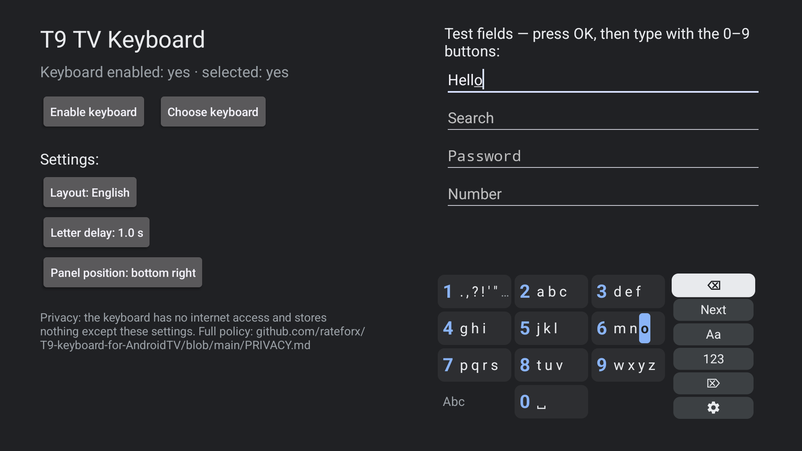

# T9 TV Keyboard

An on-screen keyboard for **Android TV / Google TV** that lets you type with the **0–9 buttons of
your TV remote**, like an old phone (multi-tap: press `2` three times for “c”). It is much faster
than walking an on-screen keyboard with the D-pad.



- **Multi-tap typing** with a small cheat sheet of the keypad. The letter being picked is
  highlighted, and it is confirmed after a short delay or when you press another key.
- **Compact panel** that floats over the app instead of covering the whole bottom of the screen.
  Choose its position: any corner, top or bottom center, or the screen center.
- **Modes:** `abc`, `Abc` (capital letter at the start of a sentence), `ABC`, and `123`. Number,
  phone and date fields start in `123`. Password, e-mail and URL fields start in lower case, and
  e-mail/URL fields put `@ . /` first on key `1`.
- **Layouts:** English and Polish (with `ą ć ę ł ń ó ś ź ż`). New languages are plain JSON files.
- **Tiny and private:** about 55 KB, no permissions at all (not even internet access), no
  third-party libraries, no tracking. See the [privacy policy](PRIVACY.md).

## Install

1. Download the APK from the [latest release](../../releases/latest).
2. Get it onto the TV, for example:
   - with the *Downloader* app (enter the APK's download link), or *Send Files to TV*, or a USB
     drive and a file manager, then allow installing apps from that source;
   - or over ADB: `adb install T9-TV-Keyboard-<version>.apk`.
3. Open **T9 TV Keyboard** from the apps row and follow the setup screen:
   - **Enable keyboard** opens the system keyboard settings. Turn on *T9 TV Keyboard*.
   - **Choose keyboard** makes it the current keyboard.
4. Try it in the test fields on the right of the setup screen.

Updates install over the previous version as long as they come from this repository's releases
(they are signed with the same key).

## Using it

The panel appears when you press a digit while a text field is focused. Digits outside text
fields still reach the app, so e.g. channel switching keeps working.

| Key | What it does |
|---|---|
| `2`–`9` | Letters (`2` = a b c, … `9` = w x y z), then the digit itself |
| `1` | Punctuation: `. , ? ! ' " - ( ) : ; / @ _`, then `1` |
| `0` | Space, then `0` |
| Hold a digit | Types the digit right away |
| ◀ / ▶ | Move the text cursor (▶ also confirms the pending letter) |
| ▲ / ▼ | Move the highlight in the button column |
| OK | Press the highlighted button (holding OK on ⌫ or ⌦ repeats) |
| Back | Hide the keyboard |

The button column, top to bottom: **⌫** backspace, **action** (Search / Next / Done… as the app
asks), **Aa** (abc → Abc → ABC), **123** (digits ↔ letters), **⌦** delete forward, and **⚙**
(opens the settings).

**Settings** (from the launcher icon or the ⚙ button): key layout, letter delay (0.6–2.0 s),
panel position.

### Known limitations

- Apps that draw **their own on-screen keyboard** never call the system keyboard, so this one
  cannot appear there. Examples are the official YouTube, Netflix and Disney+ apps. Tested with
  SmartTube and Stremio search; it should work wherever Gboard does (system settings, browsers,
  most login forms).
- The panel floats over the app. If it covers the field you are typing in, move it in the
  settings.

## Building

Requirements: JDK 17 or newer and the Android SDK (compile SDK 36).

```sh
./gradlew test             # unit tests (multi-tap engine, sentence case, every layout file)
./gradlew assembleDebug    # app/build/outputs/apk/debug/, installs next to the release as "(debug)"
./gradlew assembleRelease  # unsigned unless signing is configured (below)
```

To sign release builds, add your keystore to the git-ignored `local.properties`:

```properties
release.storeFile=/path/to/your-release.jks
release.storePassword=…
release.keyAlias=…
release.keyPassword=…
```

The app has no runtime dependencies: plain Kotlin and Android framework APIs (`InputMethodService`
and a single canvas-drawn `View`), minSdk 21.

### Adding a layout

A layout is one file in [`app/src/main/assets/layouts/`](app/src/main/assets/layouts/), for
example `de.json`:

```json
{
  "name": "Deutsch",
  "locale": "de",
  "keys": { "1": ".,?!'\"-():;/@_", "2": "abcä", "3": "def", "4": "ghi", "5": "jkl",
            "6": "mnoö", "7": "pqrsß", "8": "tuvü", "9": "wxyz", "0": " " },
  "webKeys": { "1": "@./:_-,?!'\"();" }
}
```

- `keys`: the characters of each key in cycle order. The digit is added at the end automatically.
- `webKeys` (optional): overrides for e-mail and URL fields.
- `locale`: used for upper-casing (e.g. Turkish `i` → `İ`).

`./gradlew test` validates every layout file (keys `0`–`9`, no digits, no duplicates), and the
layout appears in the settings without code changes. Pull requests with new layouts are welcome.

## License

[GPL-3.0](LICENSE) © rateforx.

The settings icon is from [Material Icons](https://github.com/google/material-design-icons)
(Apache License 2.0).

“T9” is a trademark of its owner. This project is not affiliated with or endorsed by it; the
name only describes the keypad typing style.
